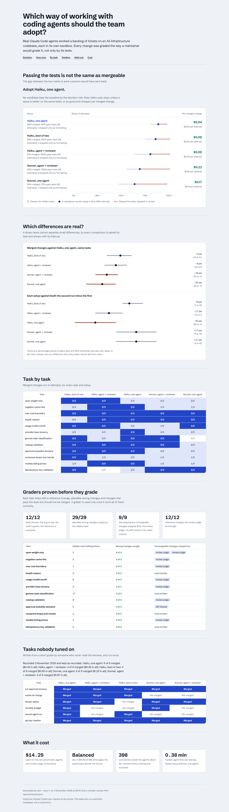

# agentic-engineering-harness

**How should an AI-native engineering team work with coding agents?** One agent per ticket, an agent
plus an independent reviewer, two agents racing with a selector; a small model or a large one. Teams
usually decide that from impressions. This repository decides it from measurements. Real Claude Code
agents work a backlog of tickets on a production-style AI-infrastructure codebase, each in its own
sandbox and in parallel. Every change is graded the way the maintainer who merges it would grade it.
The setups are compared on the same tasks, with the uncertainty a dozen tasks really carry.

## Results



Real Claude Code sessions (Claude Code 2.1.316, Haiku and Sonnet) on
[model-router-platform](https://github.com/manojrevenkar12-web/model-router-platform), an LLM gateway with
billing, tenancy and agent runs. **180 attempts** on 12 dev tasks (5 setups × 3 samples) and **30 on 6
held-out tasks** (5 setups, once). Every number below is generated into [docs/REPORT.md](docs/REPORT.md) and
`reports/results.json`; intervals are 90% bootstrap intervals over tasks.

| Setup | Tests pass | Accepted | Rejected after tests pass (formatting only) | Cost per accepted change | Held-out, first run |
|---|---:|---:|---:|---:|---:|
| Haiku, one agent (baseline) | 97% | **89%** (81–97%) | 3 (1) | **$0.04** | **6 of 6** |
| Haiku, best of two + selector | 100% | 86% (75–94%) | 5 (3) | $0.06 | 4 of 6 |
| Haiku, agent + reviewer | 100% | 81% (64–94%) | 7 (6) | $0.06 | 4 of 6 |
| Sonnet, agent + reviewer | 100% | 69% (56–83%) | 11 (8) | $0.22 | 3 of 6 |
| Sonnet, one agent | 97% | 64% (47–78%) | 12 (7) | $0.17 | 4 of 6 |

**Decision: keep one Haiku agent per ticket, and run the formatter after it.**

1. **Passing the tests is not the same as mergeable.** Nearly every change passed the hidden tests and
   the full suite; 38 of 178 test-passing changes would still have been sent back. On the held-out set it
   was 6 of 27.
2. **Most of that gap was formatting, not quality.** 25 of the 38 dev rejections were stopped only by
   `ruff format`; each had passed every other check, the review judge included. Counting them as
   accepted (exact, not a new measurement: the formatter changes layout only), every setup is within noise
   of the baseline: Sonnet with a reviewer ties it at 92% and costs **5.7× more per accepted change**. The
   held-out run says the same: all 6 of its test-passing rejections were formatting only. The cheapest fix is a hook,
   not a bigger model. The hook itself has not yet been run on a blind set.
3. **The review judge caught real bugs the tests missed.** 11 dev rejections came from the judge: money
   returned as float in `/v1/models` (4), a year `0000` that still crashes the usage report (2), an address
   without `@` treated as internal (1), a doubt about how prices are parsed (1), and a negative cut in history compression (3). The last one is
   the same bug the judge found in my own reference change while I was proving the graders. I first took
   it for a false alarm; it is not (3 non-system messages with `keep_last=4` condense two turns that
   should be kept), and the D10 hidden tests do not cover it yet.
4. **One run decides nothing.** Haiku's second sample accepted 8 of 12 tasks where its first and third
   accepted 12 of 12: 33 points between two runs of the same setup on the same tasks. A single benchmark
   run would have ranked the setups by luck; the paired intervals and the A/A comparison are why the
   decision rule only switches on differences larger than that.
5. **Spend.** $14.25 for the dev benchmark (agents $9.47, review judge $4.78), $4.57 for the held-out run.
   The $40 budget held at every moment: $25.65 was committed, because $11.40 of reservations belonged to
   workers killed by two container restarts and a time limit, and an unknown spend counts as spent.

### What building it found

- **A midnight flake in the target.** 84 dev attempts graded between 00:00 and 01:00 CET failed one
  existing test, which compares `date.today()` (local) with UTC timestamps. The grader now pins
  `TZ=UTC`; `aeh regrade` graded the stored patches again without re-running any agent (66 verdicts
  changed), and every first grade is kept in the record under `previous`.
- **A prompt leak.** The writer of the held-out set could see a dev judge prompt in the process list.
  Prompts now go on stdin ([tasks/heldout/README.md](tasks/heldout/README.md) records it).
- **A judge without tools stalls**: it tried to investigate the repository and could not. It now gets
  Read, Grep and Glob, and one retry.
- **Large agent events** crashed 3 attempts (an asyncio line limit). The limit is raised and
  `aeh requeue` re-runs failed attempts; their reservations stay counted.
- **398 refused commands.** Mostly shell pipelines, heredocs and `python` instead of `python3`: the
  allow-list matches whole commands. The trade-off is kept on purpose: least privilege over convenience.

### Limits

- One codebase, which I wrote, and 18 tasks: the intervals are wide and say nothing about other teams' code.
- The held-out tasks were written by a separate Claude session that was given only
  [tasks/WRITING_TASKS.md](tasks/WRITING_TASKS.md) and the target, not by a person.
- The review judge is one Sonnet sample. It passed all 18 reference changes and stopped 12 of the 13
  planted unmergeable ones (diff checks stopped the 13th), but it can still miss or over-block.
- Costs are Claude Code's own reports at list prices; time is wall-clock on a 2-CPU machine.


## Why "passes the tests" is the wrong number

METR had the maintainers of scikit-learn, Sphinx and pytest review 296 agent changes that passed
SWE-bench's tests. About half would not have been merged. A team pays for that gap in review time,
or in what slips through review. So the unit here is the **accepted change**, and an attempt counts
only when all of these hold:

1. the task's **hidden tests** pass (the agent never sees them);
2. the repository's **own test suite** passes, run from the original test files, so editing a test
   to make it pass earns nothing;
3. **format, lint and type checks** pass;
4. no **diff finding** that blocks: a deleted test, removed assertions, a skipped test, a removed
   invariant marker;
5. a **review judge** finds nothing the maintainer would block. The judge reads the repository's
   AGENTS.md, the ticket and the diff, and it may read files (Read, Grep and Glob only).

Cost is reported **per accepted change**, not per attempt.

## Graders are proven before they grade

Each task ships with more than tests (see [tasks/WRITING_TASKS.md](tasks/WRITING_TASKS.md)):

- a **reference change** a maintainer would merge;
- **mutants**, the plausible wrong changes engineers and agents actually make: the boundary case,
  the second code path, the wrong error shape;
- **unmergeable changes** that pass every test and break a repository rule: a query that bypasses
  row-level security, money as float, a hard-coded model list, an unrelated price change, a deleted
  assertion.

`aeh prove` checks four things before a task may be used: the task state fails its hidden tests,
the existing suite still passes, the reference is accepted, and every mutant is caught. The
unmergeable changes measure the review step. The CI job `graders` re-proves every task against the
real target on every push.

## How it works

```
tasks/<set>/<id>/brief.md ──► task state: the pinned commit + setup.patch, exported with no git history
                                   │
         ┌─────────────────────────┼──────────────────────────┐
         ▼                         ▼                          ▼
   attempt (worktree,        attempt (worktree,         attempt ...         ◄── leased from PostgreSQL,
   own DB + Redis index)     own DB + Redis index)                              worst-case spend reserved first
         │  claude -p, least privilege, hard $ cap, prompt on stdin
         ▼
   flow: solo │ executor → independent reviewer → one revision │ two executors → selector
         ▼
   patch ──► grader (fresh copy): hidden tests · original suite · ruff/mypy · diff checks · review judge
         ▼
   PostgreSQL record (attempts, append-only spend log) ──► paired bootstrap over tasks ──► decision rule
```

- **Least privilege** ([ADR 2](docs/adr/0002-least-privilege-agent-sessions.md)). Every session gets
  a clean environment, `--restricted` file tools confined to its worktree, and an allow-list of
  commands: the project's tests, linters, type checker and read-only git. Anything else is refused
  without asking, and each refusal is recorded. `--max-budget-usd` caps each session.
- **Budget** ([ADR 3](docs/adr/0003-reserve-before-spend.md)). An attempt's worst case is reserved
  in the same transaction that leases it. A crashed worker's reservation counts as spent. Results
  are written only by the worker that holds the lease. The spend log is append-only.
- **Decisions** ([ADR 4](docs/adr/0004-decide-with-paired-intervals.md)). Setups are compared paired
  by task, with bootstrap intervals over tasks. Each setup is also compared with itself (A/A) to show
  the size of pure noise. The rule lives in `config/decision.yaml`.
- **Held-out tasks** were written blind from the guide alone, by someone who never read the harness
  or the dev tasks. They run once, and the first run is never rewritten.

## Run it

```bash
pip install -e ".[dev]"
pytest -q                                            # unit + isolation; add AEH_TEST_DATABASE_URL for the whole loop
aeh prove --set dev                                  # prove every grader (PostgreSQL with pgvector, Redis)
aeh bench --set dev --run dev-1 --setups haiku-solo,sonnet-solo --samples 3 --budget 40
aeh status --run dev-1                               # progress, spend, and the budget check
aeh regrade --run dev-1                              # grade stored patches again after a grading fix
aeh heldout --setups haiku-solo,haiku-review,haiku-best2,sonnet-solo,sonnet-review --budget 15   # once
aeh report                                           # reports/results.json and docs/REPORT.md
aeh solve --issue ticket.md --setup sonnet-review    # daily use: one ticket, the adopted setup
cd web && npm ci && npm run dev                      # the dashboard
```

Configuration: `config/setups.yaml` (what is compared), `config/agent.yaml` (what agents may do),
`config/grading.yaml` (what "accepted" means), `config/decision.yaml` (when to switch),
`config/prompts/` (every prompt, versioned with the code).
